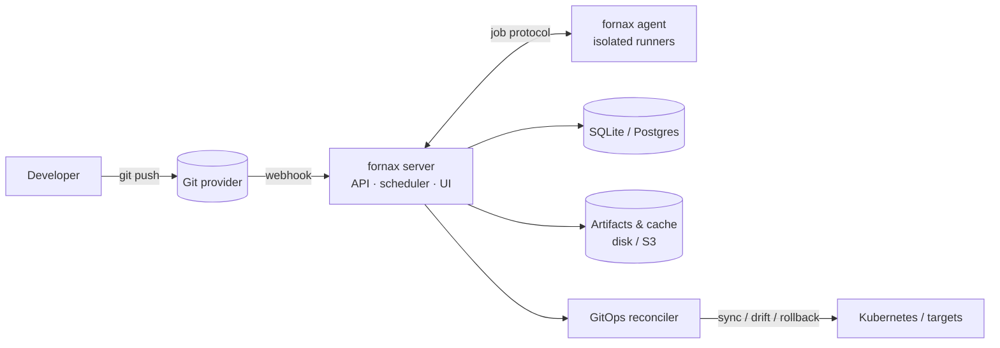

# Fornax

**Git hosting, CI/CD and GitOps delivery, in a single fast Rust binary.**

Fornax is an open-source (Apache-2.0), self-hosted-first platform that combines
**Git hosting**, **continuous integration** (pipelines, runners, artifacts, caches)
and **continuous delivery** (GitOps reconciliation, environments, promotion,
rollback) in one product. Think of GitLab plus Argo CD-style delivery, shipped as
one binary you can run on a laptop or a single VM. It also integrates with
external Git hosts.

> **Status: pre-alpha, architecture phase.** No product code exists yet.
> Everything below describes the *intended* design. Details are proposals until
> they are accepted in [`LOG.md`](LOG.md) and documented in
> [`docs/architecture.md`](docs/architecture.md).

---

## Why Fornax

| Pain today | What Fornax aims for |
|---|---|
| CI and CD are separate products with separate configs, auth and audit trails | One system: build, test, deploy and reconcile from the same Git repo |
| Heavy installs (many services, a JVM or Ruby runtime, an external queue) | One static Rust binary; SQLite for a solo dev, Postgres when you grow |
| Untrusted pull requests can reach secrets or the host | Isolated runners and no secrets for untrusted refs, by default |
| Upgrades, backups and air-gapped installs are an afterthought | Day-2 operations designed in from the start |
| Plugin sprawl and supply-chain risk | A small, versioned core with a narrow, explicit extension surface |

## Principles

1. **Git is the source of truth.** Pipelines, environments and desired
   deployment state live in Git. The platform reconciles toward them.
2. **Declarative over imperative.** You describe the end state; Fornax
   computes and executes the plan.
3. **Secure by default.** Runners are isolated, secrets are scoped,
   untrusted code gets no credentials, and every action is audited.
4. **Single binary, small footprint.** Server, agent and CLI come from one
   build. You add components only when you need scale.
5. **Boring to operate.** Predictable upgrades, built-in backup and restore,
   Prometheus metrics, OpenTelemetry traces and structured logs.

## Planned capabilities

### Git hosting
- Built-in repository hosting (push/pull over HTTPS and SSH); the MVP feature
  set (merge requests, code review, issues) is still being decided

### Continuous integration
- YAML pipeline spec with stages and an explicit job DAG (`needs:`)
- Triggers: push, merge/pull request, tag, schedule (cron), manual, API
- Matrix builds, rules and conditions, variable interpolation
- Artifacts and caches backed by local disk or S3-compatible storage
- Runners (agents) with pluggable executors: host shell first, then Docker,
  then Kubernetes; jobs and leases persisted in the database

### Continuous delivery / GitOps
- Continuous reconciliation of desired state (from Git) against live state
- Drift detection and reporting, with optional self-healing
- Environments (dev → staging → prod) with promotion and approvals
- Rollback to any previously synced revision
- Progressive delivery (canary, blue/green) planned after the core is stable

### Platform
- REST API, with gRPC for the runner protocol (proposed)
- External Git integrations, starting with Google Cloud Source Repositories,
  behind a provider-agnostic layer (GitHub, GitLab, Gitea and others to follow)
- Login via OIDC first, then LDAP, SAML and SCIM
- RBAC, audit log, scoped secrets
- Web UI and a `fornax` CLI

## Editions (open core)

Fornax follows an open-core model similar to GitLab CE/EE.

- **Community Edition (CE)** is Apache-2.0 and is a complete, useful product
  for individuals and teams: CI, runners, GitOps delivery, environments,
  basic RBAC and audit.
- **Enterprise Edition (EE)** will be a paid add-on for large organisations
  (for example SSO/SCIM, advanced compliance and audit, HA tooling and
  multi-tenant controls). EE code will live in clearly separated crates and
  directories, so the CE tree stays fully open and buildable on its own.

The exact CE/EE boundary is still being decided and will be recorded in
[`docs/architecture.md`](docs/architecture.md).

## Architecture at a glance (proposed)



Planned Rust workspace (subject to change):

| Crate | Responsibility |
|---|---|
| `fornax-core` | Pipeline spec, validation, DAG, shared domain types |
| `fornax-server` | API, scheduler/queue, webhooks, persistence |
| `fornax-agent` | Runner: claims jobs, executes them in isolation, streams logs |
| `fornax-gitops` | Reconciler: sync, drift detection, rollback, promotion |
| `fornax-api` | Wire types and protocol definitions |
| `fornax-cli` | `fornax` command-line client |

## Pipeline example (illustrative only)

The schema is not final. This shows the intended look and feel:

```yaml
# .fornax.yml
stages: [build, test, deploy]

jobs:
  build:
    stage: build
    image: rust:1
    run: cargo build --release
    artifacts: [target/release/app]

  test:
    stage: test
    needs: [build]
    image: rust:1
    run: cargo test

  deploy-staging:
    stage: deploy
    needs: [test]
    environment: staging
    gitops:
      path: deploy/staging
```

## Roadmap

| Phase | Focus |
|---|---|
| **0. Architecture** *(now)* | Research of existing FOSS tools, architecture document, decision log |
| **MVP** | Single node: Git hosting core, pipelines, DB-backed scheduler, host runner, minimal GitOps sync, CSR integration, OIDC, CLI |
| **Beta** | Docker runner, environments and promotion, RBAC, secrets, web UI, Postgres, LDAP |
| **1.0** | Kubernetes runner, SAML/SCIM, upgrades and backup/restore, observability, stable APIs |

The detailed backlog with acceptance criteria lives in [`TASKS.md`](TASKS.md).

## Project documents

| File | Purpose |
|---|---|
| [`CLAUDE.md`](CLAUDE.md) | Project brief, constraints and conventions for contributors and AI assistants |
| [`TASKS.md`](TASKS.md) | Phased backlog: status, dependencies, acceptance criteria |
| [`LOG.md`](LOG.md) | Append-only decision log |
| [`docs/architecture.md`](docs/architecture.md) | Architecture and design |
| [`docs/research/`](docs/research/) | Notes on existing tools (GitLab CE, Jenkins, Gitea, and others) |
| [`THIRD_PARTY.md`](THIRD_PARTY.md) | Third-party attributions and licenses |

*(These files are created as the architecture phase progresses.)*

## Building from source

Not available yet. Once code lands, the plan is:

```bash
cargo build --release
./target/release/fornax --help
```

## Contributing

Fornax is at the design stage, so the most useful contributions right now are
design feedback and use cases: open an issue describing your CI/CD setup, what
hurts, and what you'd need from a self-hosted platform.

Contribution rules (to be formalised in `CONTRIBUTING.md`):

- Every non-trivial design decision is recorded in `LOG.md`.
- Only code compatible with Apache-2.0 is accepted, with attribution in
  `THIRD_PARTY.md`. Nothing is copied from proprietary sources, including
  GitLab EE.

## License

Fornax Community Edition is licensed under the [Apache License 2.0](LICENSE).
