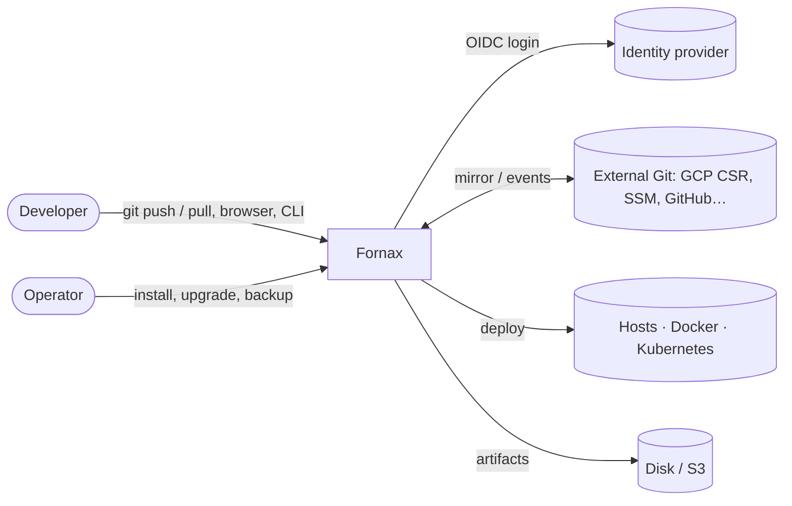
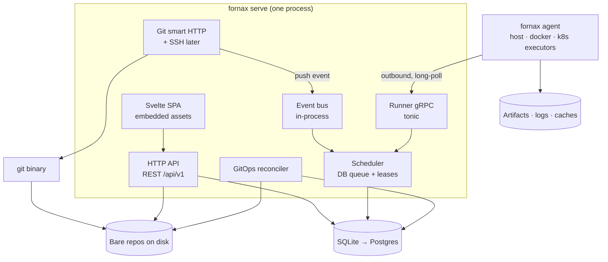

# Fornax architecture

Status: **v0.1, 2026-11-19**. Decisions referenced as `D-nnn` live in `LOG.md`.
"Proposed" = not yet built or confirmed; everything else is the accepted direction.

## 1. Goals, non-goals, principles

**Goals:** GitHub/GitLab-like Git hosting + CI + GitOps delivery in one self-hosted Rust
binary (D-009, D-026, D-028); single node first with durable DB-backed state (D-007);
secure by default; easy day-2 operations.

**Non-goals (now):** multi-node HA, SaaS, plugin marketplace, scripting DSLs (D-024),
wholesale ports of other projects.

**Principles**
1. **Git is the source of truth** — code, pipelines (`.fornax/`) and desired deploy state.
2. **Declarative** — YAML in, plans out; logic runs only inside job steps on runners.
3. **Secure by default** — least privilege, no secrets for untrusted code, everything audited.
4. **Single binary** — `fornax` = server, agent and CLI; Svelte UI embedded.
5. **Rust only in the backend** (D-026); boundaries as traits so pieces can split out later.

## 2. System context (C4 level 1)



## 3. Containers (C4 level 2)

One binary, several roles. On a single node they run in one process; `fornax agent` runs
on runner machines.



## 4. Workspace and crate boundaries

```
crates/
  fornax-core     domain types, validation (names, refs), shared errors — no I/O
  fornax-db       persistence: sqlx, migrations, queries (SQLite now, Postgres later)
  fornax-git      RepoStore: bare repos, refs, log, tree, blob, git service commands
  fornax-api      axum HTTP: REST API, auth, Git smart HTTP
  fornax-ssh      built-in SSH server (russh): pubkey auth, git-upload/receive-pack only
  fornax-server   the `fornax` binary: CLI (serve, admin, backup/restore, later agent), wiring
  -- later --
  fornax-spec     `.fornax/` YAML schema, parsing, validation, JSON Schema export (M2)
  fornax-sched    queue, leases, pipeline state machine (M2)
  fornax-proto    runner protocol (protobuf/tonic) (M2)
  fornax-agent    runner + executors: host → docker → kubernetes (M2/M3)
  fornax-gitops   sources, diff, health, sync, history (M3)
  fornax-parity   cargo-test harness replaying rust-anything corpora (as units land)
web/              Svelte 5 + Vite SPA, built to web/dist, embedded via rust-embed in fornax-api
ee/               Enterprise crates, separate license, behind a cargo feature (later)
```

Rules: `fornax-core` has no I/O; only `fornax-db` touches SQL; only `fornax-git` spawns
`git`; `fornax-api` depends on db + git + core; `fornax-server` wires and owns config. CE must
build with `ee/` absent.

## 5. Pipeline spec — `.fornax/` (M2, proposed details)

- Discovery: every `*.yaml`/`*.yml` under `.fornax/` at the pushed commit (D-024, D-027).
  Each file has `kind:` — `Pipeline` (CI) or `Deployment` (CD) — and `version: 1`.
- Suggested layout: `.fornax/pipelines/*.yaml`, `.fornax/deployments/*.yaml` (any layout
  works because of `kind`).
- Typed schema in `fornax-spec` (serde, `deny_unknown_fields`), JSON Schema exported for
  editors; errors reported with file:line.

```yaml
# .fornax/pipelines/ci.yaml
kind: Pipeline
version: 1
on:
  push: { branches: [main, "release/**"], paths: ["src/**"] }   # U2 semantics
  pull_request: {}
  schedule: ["0 3 * * 1-5"]                                      # U1 semantics
variables: { RUST_LOG: info }                                    # U3 semantics
jobs:
  build:
    runs-on: [linux, host]          # runner labels pick the executor (D-008)
    steps:
      - run: cargo build --release
    artifacts: { paths: [target/release/app], expire-in: 7d }
  test:
    needs: [build]
    steps: [{ run: cargo test }]
  deploy-staging:
    needs: [test]
    if: ${{ ref == 'refs/heads/main' }}   # expression language: open (CEL-like vs GitLab-like)
    environment: staging
    trigger-deployment: staging-app       # hands over to a Deployment (CD)
```

```yaml
# .fornax/deployments/staging-app.yaml
kind: Deployment
version: 1
environment: staging
source: { path: deploy/staging }      # rendered at a commit → immutable artifact (Flux model)
target: { type: docker-compose, host: staging-1 }
sync: { auto: true, prune: false, self-heal: false }   # opt-in, like Argo CD
promotion: { to: production, requires-approval: true }
```

## 6. Execution model, scheduler, runner protocol

- **State machine** (per job): `created → waiting(reason) → queued → claimed → running →
  success | failed | canceled | skipped`, with `waiting` reasons `dependency`, `resource`,
  `approval`, `no_runner` (Jenkins-style visibility; GitLab status set).
- **Queue** (D-014): `job_queue` table with indexed match columns; claim with a conditional
  `UPDATE … WHERE claimed_by IS NULL` (portable SQLite/Postgres); each execution = a
  `job_attempt`; attempt leases renewed by heartbeats, expiry = 3 × interval; expired →
  `lost` → retry policy. Wake-ups via in-process `tokio::sync::Notify` (Postgres
  `LISTEN/NOTIFY` later).
- **Runner protocol** (D-015, `fornax-proto`): gRPC over the HTTPS port, agent-initiated:
  `Register, Next (long-poll), Init, Extend, Update, Log (client stream), Done`. Versioned
  protobuf; no code shipping. Logs chunked with byte offsets (GitLab model), live → DB/disk,
  finished → blob store; secrets masked agent-side (U4) and server-side as a backstop.
- **Isolation:** host executor = no isolation → only trusted refs, dedicated unprivileged
  user, per-job workspace, cleanup (D-008, D-018). Docker: non-privileged by default; K8s:
  pod per job. Fork/untrusted PRs: no secrets, maintainer approval gate.

## 7. GitOps reconciler (M3)

Source → **artifact** (rendered manifests at a commit, digest-addressed) → **plan** (diff vs
live) → **sync** (phases + hooks) → **health** (per target type) → **history** (rollback =
re-sync an old artifact). Prune uses the **inventory** of the last apply (Flux). Drift:
periodic compare with jitter + event-triggered; self-heal opt-in. Targets via trait
`DeployTarget { render, diff, apply, health, inventory }`: `host` (SSH/files+systemd),
`docker-compose`, `kubernetes` (later; U5 health parity). Promotion = new `Deployment`
revision in the next environment, optionally gated by approval.

## 8. Data and storage

| Data | Store |
|---|---|
| Users, tokens, repos, pipelines, jobs, deployments, audit | SQLite (WAL, foreign keys) → Postgres (same schema, separate migration set) |
| Git repositories | bare repos `data/repos/<owner>/<name>.git` |
| Logs, artifacts, caches | `data/blobs/` → S3-compatible (trait `BlobStore`) |

Names are stored with a `lower_name` unique column (Gitea pattern) for case-insensitive
uniqueness on both databases. Backup = `fornax admin backup` (DB online backup + repos +
blobs manifest) (proposed).

## 9. Security, secrets, RBAC, audit

- **AuthN:** OIDC (D-011) for browsers; personal access tokens (`fnx_…`, stored as SHA-256)
  for API, CLI and Git over HTTP (Basic auth `user:token`). Bootstrap admin via
  `fornax admin create-user --admin` (break-glass).
- **AuthZ (M1, built):** permission levels none < read < write < admin; effective
  permission = max(site admin, owner, org role [owner→admin, member→read], team grant,
  collaborator grant, public→read) (D-031). **M4:** protected branches, finer roles.
- **Sessions (built):** OIDC login → HttpOnly SameSite=Lax cookie, hashed in the DB;
  CSRF relies on JSON bodies / non-simple methods and no CORS headers (D-031).
- **Secrets (M2):** envelope-encrypted at rest (server key outside the DB), scoped to
  repo/org/environment, injected only into jobs that declare them, never to untrusted refs.
- **Audit:** append-only `audit_events` written by every mutation from M1 on.
- **Git safety:** names and refs validated (`fornax-core`, U9 parity); revisions resolved
  with `git rev-parse --verify --end-of-options` before use; no user input reaches git as
  an option.

## 10. API, webhooks, integrations, observability

- REST `/api/v1` JSON (GitHub-like resource paths); OpenAPI export later. gRPC only for
  runners.
- Git smart HTTP at `/{owner}/{repo}.git/…` (streamed, protocol v2) and built-in SSH
  (`ssh://git@host:2222/owner/repo.git`).
- Outgoing webhooks (HMAC-signed) M4; incoming provider events: GCP CSR via Pub/Sub, SSM /
  GitHub via webhooks behind a `GitProvider` trait (D-010, D-020).
- Observability: `tracing` everywhere; Prometheus `/metrics` and OpenTelemetry export (M2);
  `/api/v1/health`.

## 11. Open-core boundary (proposed)

| CE (Apache-2.0) | EE (commercial, `ee/` crates, cargo feature `ee`) |
|---|---|
| Hosting, PRs, reviews, CODEOWNERS | Merge trains, advanced approval rules |
| CI, all executors, artifacts, caches | Runner autoscaling fleets |
| GitOps sync, drift, rollback, promotion, single approval | Multi-approver / change-window policies, compliance reports |
| OIDC, LDAP, PATs, basic RBAC | SAML, SCIM, custom roles |
| Audit log (UI + API) | Audit streaming, retention policies, SIEM export |
| Single node | HA / multi-node, geo mirrors |

Separation: EE crates implement CE traits (e.g. `AuthProvider`, `PolicyEngine`) and are
registered at startup when the feature is on; CE never imports EE.

## 12. Rust choices

| Concern | Choice | Why |
|---|---|---|
| Async runtime | tokio | ecosystem standard; process, net, sync primitives |
| HTTP | axum 0.8 | tower middleware, typed extractors, same stack as tonic |
| Runner RPC | tonic (gRPC) | streaming logs, typed contract (M2) |
| DB | sqlx (SQLite, Postgres later) | async, migrations, no ORM magic; runtime-checked queries to avoid a build-time DB |
| Serialization | serde, serde_json, serde_yaml-compatible parser for `.fornax/` | typed config |
| Errors | thiserror in libraries, anyhow in the binary | typed boundaries |
| CLI | clap 4 | derive, env vars |
| Git | `git` CLI via `tokio::process` now; gitoxide for hot reads later | D-019, D-026 |
| Tokens | getrandom + sha2 | small, audited crates |

## 13. Risks and trade-offs

| Risk | Mitigation |
|---|---|
| Hosting + CI + CD is a huge surface for a small team | Strict milestones (TASKS.md); hosting core first |
| Dependency on the `git` binary | Pin minimum version (≥ 2.38); integration tests against it; gitoxide for reads |
| SQLite write contention under CI load | Short transactions, WAL, single writer; Postgres path designed in |
| Host executor misuse | Trusted-ref only; loud docs; Docker executor next |
| Very large pushes | Streamed with a configurable cap (default 2 GiB); over-cap pushes abort cleanly |
| Expression language choice for `if:` | Decide before M2 (open question) |

Rejected: Jenkins-style scripting (D-024), Redis-backed queue (D-014), Kubernetes-only
control plane (D-008), wholesale ports (kickoff rule).
